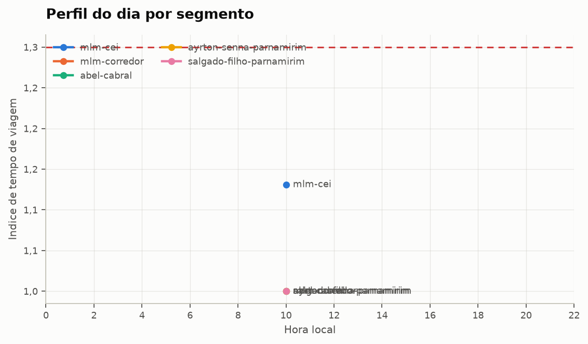

# transito-natal

Medicao propria de congestionamento viario em Natal e na conurbacao sul, porque nenhuma base
publica mede isso na cidade. O repositorio coleta a sua propria serie temporal, calcula metricas
de engenharia de trafego sobre ela e usa o resultado para discutir intervencoes concretas,
comecando pelo entorno do CEI Zona Sul, na Avenida Maria Lacerda Montenegro, em Nova Parnamirim.

## O ponto de partida

A pergunta era simples: onde Natal trava e o que da para fazer a respeito. A resposta demorou
porque o dado nao existe. O portal de mobilidade da STTU publica o catalogo estatico de linhas e
itinerarios, o anuario de sinistros mais recente e de 2018, e os numeros de 2024 e 2025 so
aparecem na imprensa citando a secretaria. Alem disso sinistro nao e congestionamento: um bairro
pode liderar o ranking de acidentes e ter fluxo livre.

Entao o projeto inverteu a ordem. Em vez de procurar um dado pronto, ele define 19 segmentos
viarios, consulta a velocidade real deles de 15 em 15 minutos nos picos e acumula a serie em
parquet. O que antes era impressao de morador vira medida com data, hora e metodo.

## O caso que originou tudo

Moro na Maria Lacerda Montenegro e o transito ali trava nos horarios do CEI Zona Sul. A avenida
tem duas funcoes que brigam entre si, corredor de ligacao com a Ayrton Senna e a BR-101, e porta
de escola, e o embarque acontece na propria pista.

A primeira medicao, as 10h34 de uma sexta-feira, fora de qualquer pico, ja mostrou o contorno do
problema:

| Trecho | Velocidade | Fluxo livre | Indice | Nivel |
| --- | --- | --- | --- | --- |
| 444 metros em frente ao portao da escola | 13 km/h | 20 km/h | 1,54 | C |
| Eixo completo da avenida, 3,4 km | 30 km/h | 36 km/h | 1,20 | B |
| Avenida Abel Cabral, rota paralela | 30 km/h | 30 km/h | 1,00 | A |

O gargalo e local, nao sistemico, e isso muda a conversa inteira: problema local aceita solucao
local e barata. A analise completa e as medidas pesquisadas estao em
[docs/propostas/entorno-cei-zona-sul.md](docs/propostas/entorno-cei-zona-sul.md).

## Achados da serie

<!-- inicio dos achados -->

Atualizado em 21/11/2026 13:54 utc pelo comando `transito relatorio`.

Serie de 10 amostras em 5 segmentos, cobrindo 1 dia, de 2026-11-21 a 2026-11-21.


### Gargalos medidos

| Via | Trecho | Municipio | Indice medio | Indice p95 | Atraso s/km | % critico | Velocidade media | Amostras |
| --- | --- | --- | --- | --- | --- | --- | --- | --- |
| Avenida Maria Lacerda Montenegro | Trecho de 444 metros em frente ao CEI Zona Sul, numero 260 | Parnamirim | 1,13 | 1,25 | 24,8 | 0 | 17,5 | 2 |
| Avenida Maria Lacerda Montenegro | Eixo completo da avenida, 3,4 quilometros ate a Ayrton Senna | Parnamirim | 1 | 1 | 0 | 0 | 35 | 2 |
| Avenida Abel Cabral | Trecho central de Nova Parnamirim | Parnamirim | 1 | 1 | 0 | 0 | 30 | 2 |
| Avenida Ayrton Senna | Portelinha, sentido Natal | Parnamirim | 1 | 1 | 0 | 0 | 33 | 2 |
| BR-101, Avenida Senador Salgado Filho | Trecho de Nova Parnamirim | Parnamirim | 1 | 1 | 0 | 0 | 70 | 2 |




### Quando o transito aperta

| Janela | Indice medio | % critico | Amostras |
| --- | --- | --- | --- |
| entrepico_manha | 1,03 | 0 | 10 |

### Por dia da semana

| Dia | Indice medio | % critico | Amostras |
| --- | --- | --- | --- |
| Saturday | 1,03 | 0 | 10 |

### Efeito da chuva

| Chovendo | Indice medio | % critico | Amostras |
| --- | --- | --- | --- |
| nao | 1,03 | 0 | 20 |

### Piores momentos registrados

| Segmento | Momento | Dia | Indice | Velocidade | Nivel |
| --- | --- | --- | --- | --- | --- |
| mlm-cei | 21/11 10:41 | Saturday | 1,26 | 15 | B |
| mlm-corredor | 21/11 10:41 | Saturday | 1 | 35 | A |
| abel-cabral | 21/11 10:41 | Saturday | 1 | 30 | A |
| ayrton-senna-parnamirim | 21/11 10:41 | Saturday | 1 | 33 | A |
| salgado-filho-parnamirim | 21/11 10:41 | Saturday | 1 | 70 | A |
| mlm-cei | 21/11 10:53 | Saturday | 1 | 20 | A |
| mlm-corredor | 21/11 10:53 | Saturday | 1 | 35 | A |
| abel-cabral | 21/11 10:53 | Saturday | 1 | 30 | A |
| ayrton-senna-parnamirim | 21/11 10:53 | Saturday | 1 | 33 | A |
| salgado-filho-parnamirim | 21/11 10:53 | Saturday | 1 | 70 | A |

<!-- fim dos achados -->

## Como funciona

A fonte primaria e o endpoint Flow Segment Data da TomTom, que devolve velocidade atual,
velocidade de fluxo livre, tempo de percurso e confianca para o segmento viario mais proximo de
um ponto. O plano gratuito da 20 mil requisicoes por mes, e esse teto e a restricao que organiza
todo o desenho do projeto.

Tres decisoes saem direto dessa restricao:

**Os segmentos entram em lotes, nao de uma vez.** Nova Parnamirim roda primeiro, Zona Sul de
Natal depois, Zona Norte por ultimo. Cada lote tem a sua cadencia por janela do dia, e o comando
`transito orcamento` projeta o consumo antes de qualquer chamada, com margem de 15% sobre o teto.

**A coleta so acontece nas janelas que importam.** Nao faz sentido gastar requisicao as tres da
manha. O piloto roda a cada 15 minutos nos tres picos, e inclui sabado e domingo de proposito,
porque so o contraste com o fim de semana prova que o gargalo e escolar.

**O zoom e calibrado por segmento.** O parametro de zoom da API nao controla escala de mapa, ele
decide a classe de via a que o ponto sera associado. O mesmo ponto em frente a escola devolve a
BR-101 em zoom 10, o trecho de 444 metros do portao em zoom 12 e o eixo de 3,4 km em zoom 15.
Sem calibrar, a medicao mede outra via.

O clima vem da Open-Meteo, que e gratuita e dispensa chave, para medir quanto a chuva piora o
indice. O agendamento roda no GitHub Actions e publica os parquets na branch `dados`, entao o
projeto inteiro funciona sem servidor e sem custo.

## Metricas

| Metrica | O que responde |
| --- | --- |
| Indice de tempo de viagem | quanto a viagem demora a mais do que em via livre, 1,0 e livre e 1,3 e o limiar de congestionamento |
| Atraso por quilometro | tempo perdido normalizado pelo comprimento, permite comparar 444 metros com 7 quilometros |
| Indice de planejamento | percentil 95 do indice, quanto tempo reservar para chegar no horario em 19 de cada 20 dias |
| Indice de buffer | imprevisibilidade da via, dois corredores com a mesma media podem ser experiencias diferentes |
| Nivel de servico | classificacao de A a F pela razao entre velocidade atual e velocidade livre |

A definicao de cada uma, as limitacoes do dado e como reproduzir tudo estao em
[docs/metodologia.md](docs/metodologia.md).

## Arquitetura

O projeto usa portas e adaptadores, com o dominio no centro e sem conhecer rede, arquivo ou
formato.

```
src/transito_natal/
  domain/      entidades, metricas e janelas do dia, tudo puro e testavel sem rede
  ports/       protocolos de fonte de trafego, fonte de clima e repositorio
  adapters/    tomtom, openmeteo, catalogo em yaml e persistencia em parquet
  application/ caso de uso de coleta, com tolerancia a falha e corte por limite de cota
  analytics/   consultas duckdb sobre os parquets
  reporting/   graficos, mapa, tabelas e injecao no leia-me
  cli.py       interface de linha de comando
config/segmentos.yaml   catalogo de lotes, segmentos, zoom e cadencia
```

Isso nao e enfeite de arquitetura, resolve tres problemas reais do projeto:

**Trocar de provedor custa um arquivo.** Se a TomTom mudar o plano gratuito, escrever um
adaptador HERE ou Mapbox nao encosta na analise nem no dominio.

**Os testes rodam sem rede e sem cota.** As 77 verificacoes usam duplos de teste e HTTP simulado,
entao a suite nao gasta requisicao nem depende da API estar no ar.

**A regra mora em um lugar so.** O limiar de congestionamento de 1,3 e as faixas de nivel de
servico sao constantes do dominio, e a camada SQL gera as suas clausulas `CASE` a partir delas.
Mudar o limiar muda grafico, tabela, consulta e CLI ao mesmo tempo.

## Comandos

```bash
uv sync
cp .env.example .env            # coloque a sua chave da TomTom aqui

uv run transito orcamento       # projeta o consumo mensal por lote
uv run transito segmentos       # lista os lotes e os segmentos cadastrados
uv run transito calibrar        # confere a que via cada ponto esta colando
uv run transito coletar         # roda uma coleta respeitando a cadencia
uv run transito analisar        # ranking de gargalos e perfil por janela
uv run transito relatorio       # gera graficos, mapa e atualiza este leia-me
uv run transito status          # cobertura da serie e vida restante da cota
```

## Se voce chegou aqui para estudar

As partes que valem a leitura, na ordem:

1. [`domain/metricas.py`](src/transito_natal/domain/metricas.py) e
   [`domain/orcamento.py`](src/transito_natal/domain/orcamento.py), que mostram como transformar
   uma restricao externa, 20 mil requisicoes por mes, em modelo de dominio com teste.
2. [`application/coleta.py`](src/transito_natal/application/coleta.py), um caso de uso que
   distingue falha toleravel de falha fatal: um segmento fora do ar nao derruba a rodada, mas
   cota esgotada interrompe tudo na hora.
3. [`analytics/analise.py`](src/transito_natal/analytics/analise.py), que deriva o esquema SQL do
   mesmo esquema Arrow usado na gravacao, em vez de manter as duas definicoes em paralelo.
4. [`docs/metodologia.md`](docs/metodologia.md), em especial a secao de limitacoes, que e a parte
   mais importante de qualquer trabalho com dado de terceiro.
5. [`reporting/estilo.py`](src/transito_natal/reporting/estilo.py), com a paleta verificada para
   daltonismo em vez de escolhida no olho.

## Licenca

MIT. Os dados coletados seguem os termos de uso da TomTom e da Open-Meteo.
