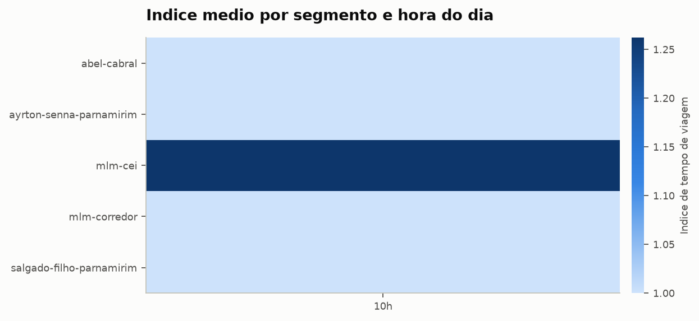

# transito-rn

Diagnóstico de trânsito do Rio Grande do Norte: onde o estado trava, onde o estado morre, e o que
dá para fazer em cada caso.

## Duas perguntas, duas fontes

**Onde trava** nenhuma base pública responde. O portal de mobilidade da STTU publica só o catálogo
estático de linhas e itinerários, e fora de Natal não existe medição nenhuma. Então o projeto mede
por conta própria: 42 segmentos viários consultados nos horários de pico, acumulando série em
parquet.

**Onde morre** a PRF responde desde 2007. A base de sinistros em rodovias federais traz BR,
quilômetro, causa, tipo, clima e vítimas de cada ocorrência, e dá para rankear os trechos mais
letais do RN hoje, sem esperar série nenhuma.

As duas perguntas são diferentes e as respostas também. Um trecho pode ser lento e seguro, ou
rápido e letal. Lagoa Nova lidera os sinistros de Natal e nem por isso lidera o congestionamento.

## Cobertura

| Lote | Onde | Segmentos |
| --- | --- | --- |
| parnamirim-cei | Entorno do CEI Zona Sul, em Nova Parnamirim | 3 |
| natal-zona-sul | Ponta Negra, Lagoa Nova, Capim Macio | 5 |
| natal-zona-leste | Tirol, Petrópolis, Alecrim, Ribeira, Cidade Alta | 5 |
| natal-zona-norte | Travessias do Potengi, Potengi, Igapó, Lagoa Azul | 5 |
| natal-zona-oeste | Bom Pastor, Dix-Sept Rosado, Nordeste, Felipe Camarão | 5 |
| regiao-metropolitana | Parnamirim, São Gonçalo, Macaíba, Extremoz | 6 |
| mossoro | Presidente Dutra, Rio Branco, Francisco Mota | 4 |
| interior-regional | Currais Novos, Caicó, Assu, Pau dos Ferros | 4 |
| corredores-rodoviarios | BR-101, BR-304, BR-226, BR-405, RN-063 | 5 |

Os lotes entram em operação aos poucos, não todos juntos, porque o teto da API é mensal e o
consumo precisa ser observado antes de crescer.

## O caso que abriu o projeto

A Avenida Maria Lacerda Montenegro, em Nova Parnamirim, é corredor de ligação com a Ayrton Senna e
a BR-101, e ao mesmo tempo porta do CEI Zona Sul. O embarque de alunos ocupa a pista no mesmo
horário em que o fluxo de passagem está no pico.

Três medições num único dia, fora de qualquer obra ou acidente:

| Horário | Trecho do portão | Resto do lote |
| --- | --- | --- |
| 10h34 | índice 1,54, nível C | 1,20 e 1,00 |
| 10h41 | índice 1,26 | 1,00 |
| 11h07 | índice 1,32, classificado como congestionado | 1,00 |

O gargalo é o portão, não a avenida, e dura cerca de doze minutos por vez. Problema local aceita
solução local, que é o oposto de obra viária. As medidas pesquisadas, ordenadas por força de
evidência, estão em
[docs/propostas/entorno-cei-zona-sul.md](docs/propostas/entorno-cei-zona-sul.md).

Esse caso é o método em escala pequena, não o objetivo do projeto. O mesmo tratamento se aplica a
qualquer um dos 42 segmentos assim que a série deles encher.

## Achados da série

<!-- inicio dos achados -->

Atualizado em 21/11/2026 14:26 utc pelo comando `transito relatorio`.

Série de 10 amostras em 5 segmentos, cobrindo 1 dia, de 2026-11-21 a 2026-11-21.


### Gargalos medidos

| Via | Trecho | Município | Índice médio | Índice p95 | Atraso s/km | % crítico | Velocidade média | Amostras |
| --- | --- | --- | --- | --- | --- | --- | --- | --- |
| Avenida Maria Lacerda Montenegro | Trecho de 444 metros em frente ao CEI Zona Sul, número 260 | Parnamirim | 1,13 | 1,25 | 24,8 | 0 | 17,5 | 2 |
| Avenida Abel Cabral | Trecho central de Nova Parnamirim | Parnamirim | 1 | 1 | 0 | 0 | 30 | 2 |
| Avenida Ayrton Senna | Portelinha, sentido Natal | Parnamirim | 1 | 1 | 0 | 0 | 33 | 2 |
| Avenida Maria Lacerda Montenegro | Eixo completo da avenida, 3,4 quilômetros até a Ayrton Senna | Parnamirim | 1 | 1 | 0 | 0 | 35 | 2 |
| BR-101, Avenida Senador Salgado Filho | Trecho de Nova Parnamirim | Parnamirim | 1 | 1 | 0 | 0 | 70 | 2 |




### Quando o trânsito aperta

| Janela | Índice médio | % crítico | Amostras |
| --- | --- | --- | --- |
| entrepico_manha | 1,03 | 0 | 10 |

### Por dia da semana

| Dia | Índice médio | % crítico | Amostras |
| --- | --- | --- | --- |
| Saturday | 1,03 | 0 | 10 |

### Efeito da chuva

| Chovendo | Índice médio | % crítico | Amostras |
| --- | --- | --- | --- |
| não | 1,03 | 0 | 20 |

### Piores momentos registrados

| Segmento | Momento | Dia | Índice | Velocidade | Nível |
| --- | --- | --- | --- | --- | --- |
| mlm-cei | 21/11 10:41 | Saturday | 1,26 | 15 | B |
| abel-cabral | 21/11 10:41 | Saturday | 1 | 30 | A |
| abel-cabral | 21/11 10:53 | Saturday | 1 | 30 | A |
| ayrton-senna-parnamirim | 21/11 10:41 | Saturday | 1 | 33 | A |
| ayrton-senna-parnamirim | 21/11 10:53 | Saturday | 1 | 33 | A |
| mlm-cei | 21/11 10:53 | Saturday | 1 | 20 | A |
| mlm-corredor | 21/11 10:41 | Saturday | 1 | 35 | A |
| mlm-corredor | 21/11 10:53 | Saturday | 1 | 35 | A |
| salgado-filho-parnamirim | 21/11 10:41 | Saturday | 1 | 70 | A |
| salgado-filho-parnamirim | 21/11 10:53 | Saturday | 1 | 70 | A |

<!-- fim dos achados -->

## Como funciona

A medição de lentidão usa o endpoint Flow Segment Data da TomTom, que devolve velocidade atual,
velocidade de fluxo livre e tempo de percurso para o ponto consultado. São 20 mil requisições por
mês no plano gratuito, e esse teto organiza o projeto inteiro.

**Lotes, não tudo de uma vez.** O comando `transito orcamento` projeta o consumo antes de gastar e
recusa plano acima do teto. Com os nove lotes ligados, a projeção é de 15.446 requisições por mês,
77% do limite.

**Só nas janelas que importam.** O piloto roda a cada 15 minutos nos picos e inclui o fim de
semana de propósito, porque sem esse contraste nada prova que o gargalo é escolar. As zonas de
Natal rodam a cada 30 minutos em dias úteis, Mossoró e o interior a cada 60, as rodovias a cada
120.

**Zoom calibrado por segmento.** O zoom da API não é escala de mapa, é a classe de via escolhida.
O mesmo ponto devolve a BR-101 em zoom 10 e o trecho do portão da escola em zoom 12. Sem calibrar,
você mede outra rua.

Os sinistros da PRF entram por fora, porque os arquivos ficam em links do Google Drive sem padrão
de URL. Você baixa os CSV anuais, joga em `data/externo/prf/` e roda `transito importar-prf`, que
filtra o RN, trata a vírgula decimal do quilômetro e grava em parquet.

Chuva vem da Open-Meteo, grátis e sem chave. O agendamento roda no GitHub Actions e publica os
parquets na branch `dados`, então não há servidor nem custo.

## Métricas

| Métrica | O que responde |
| --- | --- |
| Índice de tempo de viagem | quanto a viagem demora a mais do que em via livre, 1,0 é livre e 1,3 é o limiar |
| Atraso por quilômetro | tempo perdido normalizado, compara 444 metros com 7 quilômetros |
| Índice de planejamento | percentil 95, quanto reservar para chegar no horário em 19 de cada 20 dias |
| Índice de buffer | imprevisibilidade, duas vias com a mesma média podem ser bem diferentes |
| Nível de serviço | classificação de A a F pela razão entre velocidade atual e livre |
| Letalidade por ocorrência | mortes a cada cem sinistros, separa trecho perigoso de trecho movimentado |

Definições, limitações e como reproduzir estão em [docs/metodologia.md](docs/metodologia.md).

## Arquitetura

```
src/transito_rn/
  domain/      entidades, métricas e janelas do dia, puro e testável sem rede
  ports/       protocolos de fonte de tráfego, clima e repositório
  adapters/    tomtom, openmeteo, prf, catálogo em yaml, parquet
  application/ caso de uso de coleta, tolera falha e corta por limite de cota
  analytics/   consultas duckdb sobre lentidão e sobre sinistros
  reporting/   gráficos, mapa, tabelas e injeção no leia-me
  cli.py       linha de comando
config/segmentos.yaml   lotes, segmentos, zoom e cadência
```

Portas e adaptadores aqui resolve três coisas concretas:

- trocar TomTom por HERE ou Mapbox custa um arquivo, sem tocar na análise;
- os testes rodam sem rede e sem gastar cota, com duplos e HTTP simulado;
- o limiar de 1,3 e as faixas de nível vivem no domínio, e a camada SQL monta os `CASE` a partir
  deles, então mudar a regra muda gráfico, tabela e consulta de uma vez.

## Comandos

```bash
uv sync
cp .env.example .env            # chave da TomTom aqui

uv run transito orcamento       # consumo mensal projetado por lote
uv run transito segmentos       # lotes e segmentos cadastrados
uv run transito calibrar        # confere a que via cada ponto está colando
uv run transito coletar         # uma coleta, respeitando a cadência
uv run transito analisar        # ranking de gargalos e perfil por janela
uv run transito importar-prf    # ingere os csv de sinistros da PRF
uv run transito sinistros       # trechos e municípios mais letais do estado
uv run transito relatorio       # gráficos, mapa e atualiza este leia-me
uv run transito status          # cobertura da série e vida restante da cota
```

O `relatorio` também gera `docs/mapa.html`, fora do controle de versão porque o folium cria
identificadores novos a cada execução.

## Para quem veio estudar

1. [`domain/metricas.py`](src/transito_rn/domain/metricas.py) e
   [`domain/orcamento.py`](src/transito_rn/domain/orcamento.py): transformar uma restrição externa,
   20 mil requisições por mês, em modelo de domínio testável.
2. [`application/coleta.py`](src/transito_rn/application/coleta.py): separar falha tolerável de
   falha fatal. Um segmento fora do ar não derruba a rodada, cota esgotada interrompe na hora.
3. [`adapters/prf/importacao.py`](src/transito_rn/adapters/prf/importacao.py): ingerir base pública
   que muda de esquema entre anos, exigindo só o núcleo e tolerando o resto.
4. [`analytics/analise.py`](src/transito_rn/analytics/analise.py): derivar o esquema SQL do mesmo
   esquema Arrow da gravação, em vez de manter as duas definições em paralelo.
5. [`docs/metodologia.md`](docs/metodologia.md), em especial as limitações, que é a parte mais
   importante de qualquer trabalho com dado de terceiro.

## Licença

MIT. Os dados seguem os termos de uso da TomTom, da Open-Meteo e da PRF.
