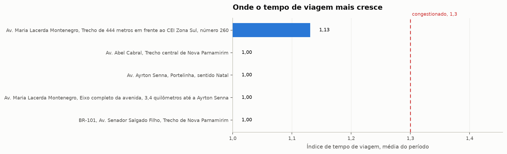

# transito-natal

Mede congestionamento em Natal e na conurbação sul coletando a própria série de dados, porque
nenhuma base pública mede isso na cidade.

## Por que existe

Natal não tem dado aberto de congestionamento. O portal da STTU publica só o catálogo estático de
linhas e itinerários, e o anuário de sinistros mais recente é de 2018.

Sinistro também não é congestionamento: um bairro pode liderar o ranking de acidentes e ter fluxo
livre.

Então o projeto define 19 segmentos viários, mede a velocidade real deles de 15 em 15 minutos nos
picos e guarda tudo em parquet. Impressão vira medida, com data, hora e método.

## O caso que originou tudo

A Avenida Maria Lacerda Montenegro, em Nova Parnamirim, é corredor de ligação com a Ayrton Senna
e a BR-101, e ao mesmo tempo porta do CEI Zona Sul. O embarque de alunos acontece na pista, no
mesmo horário em que o fluxo de passagem está no pico.

Primeira medição, 10h34 de uma sexta, fora de pico:

| Trecho | Velocidade | Fluxo livre | Índice | Nível |
| --- | --- | --- | --- | --- |
| 444 m em frente ao portão | 13 km/h | 20 km/h | 1,54 | C |
| Eixo completo, 3,4 km | 30 km/h | 36 km/h | 1,20 | B |
| Abel Cabral, rota paralela | 30 km/h | 30 km/h | 1,00 | A |

O gargalo é local, não sistêmico. Isso muda tudo, porque problema local aceita solução barata.
As medidas pesquisadas estão em
[docs/propostas/entorno-cei-zona-sul.md](docs/propostas/entorno-cei-zona-sul.md).

## Achados da série

<!-- inicio dos achados -->

Atualizado em 21/11/2026 14:03 utc pelo comando `transito relatorio`.

Série de 10 amostras em 5 segmentos, cobrindo 1 dia, de 2026-11-21 a 2026-11-21.



### Gargalos medidos

| Via | Trecho | Município | Índice médio | Índice p95 | Atraso s/km | % crítico | Velocidade média | Amostras |
| --- | --- | --- | --- | --- | --- | --- | --- | --- |
| Avenida Maria Lacerda Montenegro | Trecho de 444 metros em frente ao CEI Zona Sul, número 260 | Parnamirim | 1,13 | 1,25 | 24,8 | 0 | 17,5 | 2 |
| Avenida Abel Cabral | Trecho central de Nova Parnamirim | Parnamirim | 1 | 1 | 0 | 0 | 30 | 2 |
| Avenida Ayrton Senna | Portelinha, sentido Natal | Parnamirim | 1 | 1 | 0 | 0 | 33 | 2 |
| Avenida Maria Lacerda Montenegro | Eixo completo da avenida, 3,4 quilômetros até a Ayrton Senna | Parnamirim | 1 | 1 | 0 | 0 | 35 | 2 |
| BR-101, Avenida Senador Salgado Filho | Trecho de Nova Parnamirim | Parnamirim | 1 | 1 | 0 | 0 | 70 | 2 |


### Quando o trânsito aperta

| Janela | Índice médio | % crítico | Amostras |
| --- | --- | --- | --- |
| entrepico_manha | 1,03 | 0 | 10 |

### Por dia da semana

| Dia | Índice médio | % crítico | Amostras |
| --- | --- | --- | --- |
| Saturday | 1,03 | 0 | 10 |

### Efeito da chuva

| Chovendo | Índice médio | % crítico | Amostras |
| --- | --- | --- | --- |
| não | 1,03 | 0 | 20 |

### Piores momentos registrados

| Segmento | Momento | Dia | Índice | Velocidade | Nível |
| --- | --- | --- | --- | --- | --- |
| mlm-cei | 21/11 10:41 | Saturday | 1,26 | 15 | B |
| abel-cabral | 21/11 10:41 | Saturday | 1 | 30 | A |
| abel-cabral | 21/11 10:53 | Saturday | 1 | 30 | A |
| ayrton-senna-parnamirim | 21/11 10:41 | Saturday | 1 | 33 | A |
| ayrton-senna-parnamirim | 21/11 10:53 | Saturday | 1 | 33 | A |
| mlm-cei | 21/11 10:53 | Saturday | 1 | 20 | A |
| mlm-corredor | 21/11 10:41 | Saturday | 1 | 35 | A |
| mlm-corredor | 21/11 10:53 | Saturday | 1 | 35 | A |
| salgado-filho-parnamirim | 21/11 10:41 | Saturday | 1 | 70 | A |
| salgado-filho-parnamirim | 21/11 10:53 | Saturday | 1 | 70 | A |

<!-- fim dos achados -->

## Como funciona

A fonte é o endpoint Flow Segment Data da TomTom, que devolve velocidade atual, velocidade de
fluxo livre, tempo de percurso e confiança para o ponto consultado. São 20 mil requisições por
mês no plano gratuito, e esse teto organiza o projeto inteiro.

**Lotes, não tudo de uma vez.** Nova Parnamirim primeiro, Zona Sul depois, Zona Norte por último.
O comando `transito orcamento` projeta o consumo antes de gastar.

**Só nas janelas que importam.** Não faz sentido medir às três da manhã. O piloto roda a cada 15
minutos nos picos, e inclui o fim de semana de propósito: sem esse contraste, nada prova que o
gargalo é escolar.

**Zoom calibrado por segmento.** O zoom da API não é escala de mapa, é a classe de via escolhida.
O mesmo ponto devolve a BR-101 em zoom 10 e o trecho do portão em zoom 12. Sem calibrar, você
mede outra rua.

Chuva vem da Open-Meteo, grátis e sem chave. O agendamento roda no GitHub Actions e publica os
parquets na branch `dados`, então não há servidor nem custo.

## Métricas

| Métrica | O que responde |
| --- | --- |
| Índice de tempo de viagem | quanto a viagem demora a mais do que em via livre, 1,0 é livre e 1,3 é o limiar |
| Atraso por quilômetro | tempo perdido normalizado, compara 444 metros com 7 quilômetros |
| Índice de planejamento | percentil 95, quanto reservar para chegar no horário em 19 de cada 20 dias |
| Índice de buffer | imprevisibilidade, duas vias com a mesma média podem ser bem diferentes |
| Nível de serviço | classificação de A a F pela razão entre velocidade atual e livre |

Definições, limitações e como reproduzir estão em [docs/metodologia.md](docs/metodologia.md).

## Arquitetura

```
src/transito_natal/
  domain/      entidades, métricas e janelas do dia, puro e testável sem rede
  ports/       protocolos de fonte de tráfego, clima e repositório
  adapters/    tomtom, openmeteo, catálogo em yaml, parquet
  application/ caso de uso de coleta, tolera falha e corta por limite de cota
  analytics/   consultas duckdb sobre os parquets
  reporting/   gráficos, mapa, tabelas e injeção no leia-me
  cli.py       linha de comando
config/segmentos.yaml   lotes, segmentos, zoom e cadência
```

Portas e adaptadores aqui resolve três coisas concretas:

- trocar TomTom por HERE ou Mapbox custa um arquivo, sem tocar na análise;
- os testes rodam sem rede e sem gastar cota, com duplos e HTTP simulado;
- o limiar de 1,3 e as faixas de nível vivem no domínio, e a camada SQL monta os `CASE` a partir
  deles, então mudar a regra muda gráfico, tabela e consulta de uma vez.

## Comandos

```bash
uv sync
cp .env.example .env            # chave da TomTom aqui

uv run transito orcamento       # consumo mensal projetado por lote
uv run transito segmentos       # lotes e segmentos cadastrados
uv run transito calibrar        # confere a que via cada ponto está colando
uv run transito coletar         # uma coleta, respeitando a cadência
uv run transito analisar        # ranking de gargalos e perfil por janela
uv run transito relatorio       # gráficos, mapa e atualiza este leia-me
uv run transito status          # cobertura da série e vida restante da cota
```

O `relatorio` também gera `docs/mapa.html`, fora do controle de versão porque o folium cria
identificadores novos a cada execução.

## Para quem veio estudar

1. [`domain/metricas.py`](src/transito_natal/domain/metricas.py) e
   [`domain/orcamento.py`](src/transito_natal/domain/orcamento.py): transformar uma restrição
   externa, 20 mil requisições por mês, em modelo de domínio testável.
2. [`application/coleta.py`](src/transito_natal/application/coleta.py): separar falha tolerável de
   falha fatal. Um segmento fora do ar não derruba a rodada, cota esgotada interrompe na hora.
3. [`analytics/analise.py`](src/transito_natal/analytics/analise.py): derivar o esquema SQL do
   mesmo esquema Arrow da gravação, em vez de manter as duas definições em paralelo.
4. [`docs/metodologia.md`](docs/metodologia.md), em especial as limitações, que é a parte mais
   importante de qualquer trabalho com dado de terceiro.
5. [`reporting/estilo.py`](src/transito_natal/reporting/estilo.py): paleta verificada para
   daltonismo, não escolhida no olho.

## Licença

MIT. Os dados seguem os termos de uso da TomTom e da Open-Meteo.
